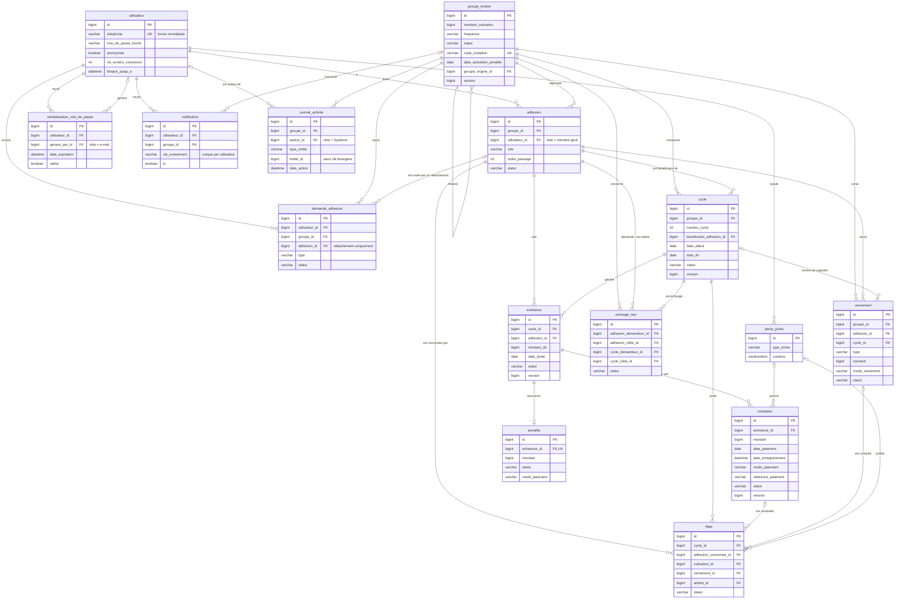

# Modèle de données

Schéma créé par la migration Flyway `src/main/resources/db/migration/V1__schema_initial.sql`, d'après la section 4 du cahier des charges. Il couvre les modules essentiels et importants ; les tables des modules optionnels (section 4.3) viendront dans des migrations suivantes.

Conventions (section 4.5) : montants en `BIGINT` (FCFA entiers), dates métier en `DATE`, horodatages en `DATETIME`, statuts en `VARCHAR` contrôlés par des contraintes `CHECK`, colonne `version` sur `groupe_tontine`, `cycle`, `echeance` et `cotisation`. Aucune suppression en cascade.

## Compléments au cahier des charges

Choix faits lors de la création du schéma, pour combler des manques du cahier (à reporter dans la section 4) :

| Ajout | Raison |
| --- | --- |
| `groupe_tontine.date_activation_penalite` | La règle « pas d'effet rétroactif » (module 7) a besoin de la date d'activation. |
| Statut `ANNULE` pour `cycle` | Le cycle d'un membre sorti avant son tour (module 4) est annulé et non supprimé : ses échéances, données financières, ne doivent jamais être supprimées. |
| Statut `SUPPRIME` pour `groupe_tontine` | Un brouillon supprimé (module 3) garde son journal d'activité, qui est immuable. |
| `demande_adhesion.adhesion_id` | Désigne le membre géré à rattacher (module 4) ; obligatoire pour un rattachement, vide pour une adhésion. |
| `penalite.mode_paiement` | Le paiement d'une pénalité enregistre sa date et son mode (module 7). |
| Valeurs de `versement.mode_versement` : `ESPECES`, `MOBILE_MONEY`, `VIREMENT` | Le cahier ne fixe pas ces valeurs ; `COMPENSATION` est exclu, car une compensation est une déduction de la cagnotte et non une remise d'argent. |
| `cotisation.date_enregistrement` | Moment de la saisie dans l'application, distinct de la date de paiement déclarée. |
| `utilisateur.nb_echecs_connexion`, `utilisateur.bloque_jusqu_a` | Suspension de 15 minutes après 5 échecs (module 2), conservée même si l'application redémarre. |
| `reinitialisation_mot_de_passe.date_creation` | Limite de 3 codes par compte et par 24 heures (module 2). |

## Diagramme

Pour garder le diagramme lisible, seules les clés et quelques colonnes importantes sont montrées ; la liste complète est dans le script SQL.

## Les tables

- **utilisateur** : un compte, identifié par son numéro de téléphone normalisé (unique) ; il compte les échecs de connexion pour suspendre le compte 15 minutes après 5 échecs, et ses données sont anonymisées, jamais effacées, à la suppression.
- **reinitialisation_mot_de_passe** : un code ou lien de récupération à usage unique, stocké haché, généré par l'utilisateur lui-même (e-mail) ou par un organisateur.
- **groupe_tontine** : un groupe et toutes ses règles (cotisation, fréquence, pénalités, permutations) ; `date_activation_penalite` évite toute pénalité rétroactive, un brouillon supprimé passe au statut `SUPPRIME` (son journal est conservé) et `groupe_origine_id` relie un tour relancé au précédent.
- **adhesion** : la place d'une personne dans un groupe, avec son rôle et son ordre de passage ; sans `utilisateur_id`, c'est un membre géré sans compte.
- **demande_adhesion** : une demande pour rejoindre un groupe par son code, ou pour rattacher à un compte le membre géré désigné par `adhesion_id`, en attente de la décision de l'organisateur.
- **cycle** : un tour de cotisation avec ses dates et son bénéficiaire ; les montants attendu et collecté sont calculés, pas stockés, et le cycle d'un membre sorti avant son tour passe au statut `ANNULE` au lieu d'être supprimé.
- **echeance** : ce qu'un membre doit pour un cycle (une seule par membre et par cycle) ; c'est la base des paiements, des retards, des pénalités et des litiges.
- **cotisation** : un paiement, ou une part de paiement, affecté à une échéance, avec sa date de paiement et le moment de sa saisie dans l'application ; jamais modifié ni supprimé, seulement annulé avec un motif.
- **piece_jointe** : un fichier (preuve de paiement, justificatif) stocké en base, car le disque des hébergeurs gratuits est effacé à chaque redéploiement.
- **penalite** : la pénalité de retard d'une échéance (une au maximum), recalculée chaque jour jusqu'au solde de l'échéance, avec la date et le mode de son paiement.
- **versement** : de l'argent remis par le groupe à un membre (en espèces, par Mobile Money ou par virement), soit la cagnotte d'un cycle, soit une restitution après un départ.
- **echange_tour** : une demande de permutation entre deux membres et deux cycles, qui passe par l'accord du membre ciblé puis de l'organisateur.
- **litige** : une contestation portant sur une échéance (cycle + membre), une cotisation ou une remise de cagnotte, avec sa résolution.
- **journal_activite** : la trace immuable des actions sensibles d'un groupe ; l'élément concerné est désigné par `type_entite` / `entite_id`, sans clé étrangère, pour rester lisible même si l'élément évolue.
- **notification** : un message adressé à un utilisateur ; `cle_evenement` empêche d'envoyer deux fois la même notification au même utilisateur.
